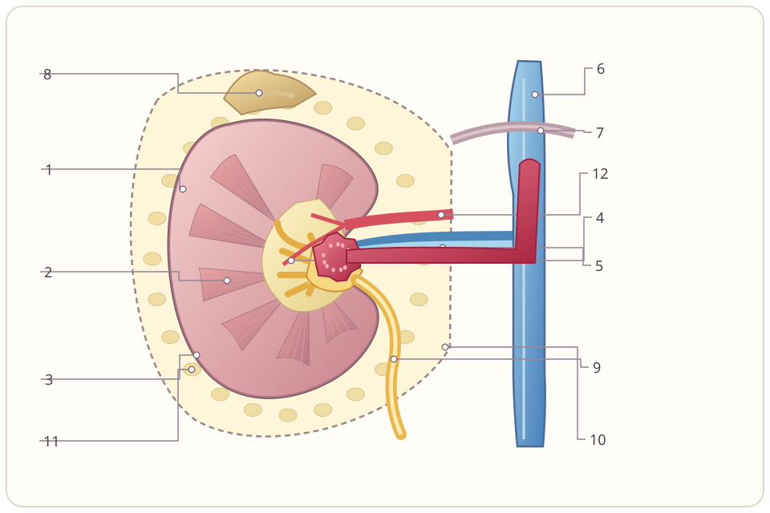
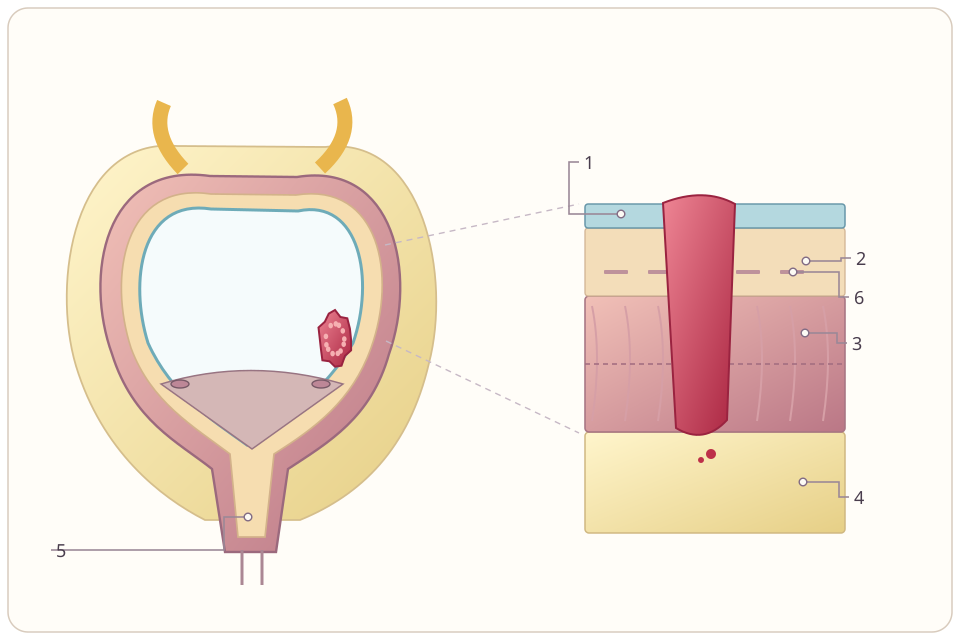
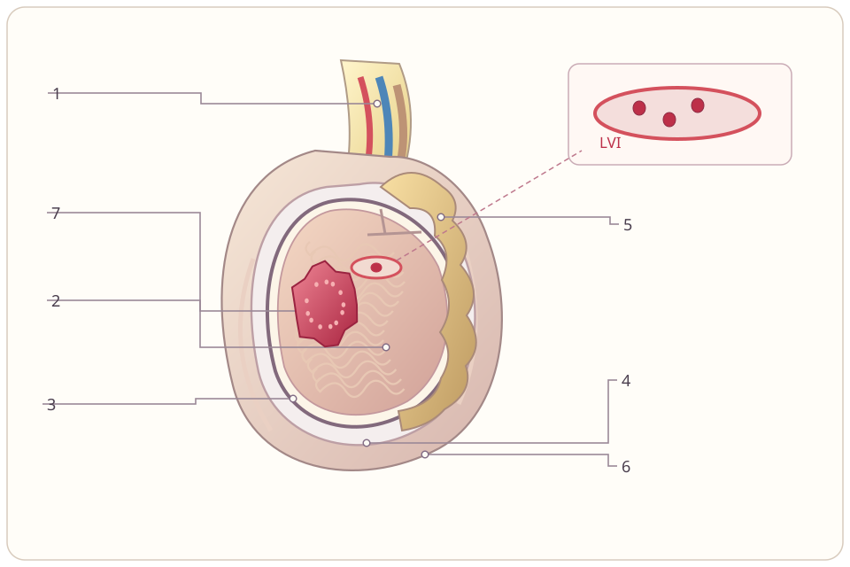

# Illustrated TNM and trauma lessons

All 14 guides now have original detailed vector sections, 135 selectable findings, numbered anatomy labels, a decisive-boundary explanation, and enlargement on mobile. cT/pT and cN/pN remain separate. Complete edition-labelled tables and the 30 clinical/operative cases are accessible below each lesson.

RCC examples distinguish perirenal fat, sinus, collecting-system and venous invasion, caval thrombus height and caval wall invasion. Bladder examples distinguish muscularis mucosae from muscularis propria and microscopic from gross extravesical disease. Other models cover prostate, UTUC, testis and LVI, penile erectile compartments, urethra and adrenal systems. Trauma models show urine leaks, disrupted continuity, devascularisation and peritoneal relationships. UTUC and urethral nodal maps depend on primary location.

The bank remains at 500 decisions in 402 active cases. Existing artwork, banter, marking/export, historical saves and six duties remain available. The scored-question flow contains no pre-answer learning objectives.

All drawings are original teaching schematics, not diagnostic imaging or to-scale surgical views. Source editions remain explicit, including AAST 2018 renal grading. Clinical sign-off metadata remains empty; code and AI review do not constitute specialist clinical validation.

## Rebuild

```sh
python scripts/illustrate_classifications.py
python scripts/manage.py validate
python -m unittest discover -s tests
node --test tests/tests-engine.cjs tests/tests-cartoon.cjs
python scripts/manage.py build
```

The strict SVG parser accepts inert shapes, text and existing local gradients. It rejects scripts, images, events, external paint servers and malformed markup. Repeated figures have isolated gradient ids. Quiz mode strips every embedded text element and omits the legend.

The recovered implementation is verified with 62 Python tests and 99 Node tests, plus real-browser checks of 135 finding selections and every guide at 390 × 844 with enlargement and no page overflow. The initially unsaved upload was interrupted by workspace cleanup; recovered source is now checkpointed on the work branch before regeneration.

## Picture preview







Numbered labels, explanations, source tables and cases are in the interactive viewer.
